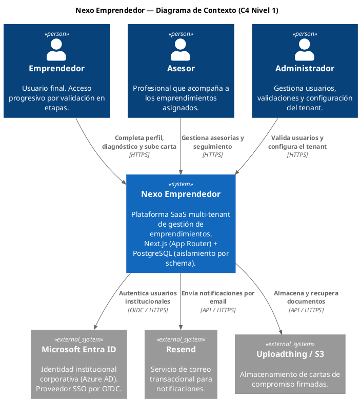
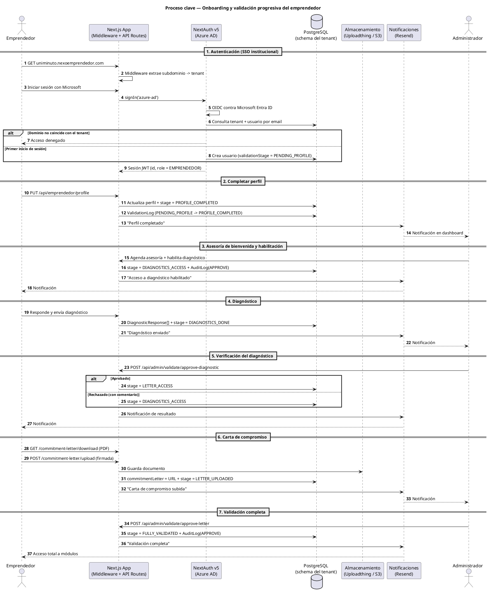

# Arquitectura — Nexo Emprendedor

Documentación viva de arquitectura del **proyecto integrador Nexo Emprendedor**. Aquí se registran las **decisiones arquitectónicas (ADRs)** y los **diagramas como código (PlantUML)**, garantizando trazabilidad completa entre **necesidad → decisión → diseño**.

> Este directorio es la fuente de verdad de la arquitectura. Las decisiones se versionan en Git: cada cambio de arquitectura se propone con un ADR y un diff en los diagramas.

---

## 1. Visión global de vistas

El sistema se documenta desde dos vistas complementarias, alineadas con el modelo C4:

| Vista | Nivel C4 | Pregunta que responde | Fuente |
|-------|----------|-----------------------|--------|
| **Contexto del sistema** | Nivel 1 | ¿Quiénes usan el sistema y con qué sistemas externos interactúa? | [`diagrams/c4-contexto.puml`](diagrams/c4-contexto.puml) |
| **Proceso clave (secuencia)** | Dinámica | ¿Cómo fluye la transacción principal de negocio, paso a paso? | [`diagrams/secuencia-proceso-clave.puml`](diagrams/secuencia-proceso-clave.puml) |

### 1.1 Contexto del Sistema (C4 Nivel 1)



Nexo Emprendedor es un **único sistema** (monolito modular, [ADR-0001](adr/0001-patron-arquitectonico.md)) que expone su interfaz a tres actores —**Emprendedor**, **Asesor** y **Administrador**— y se integra con tres sistemas externos: **Microsoft Entra ID** (SSO), **Resend** (email) y **Uploadthing/S3** (documentos).

### 1.2 Proceso clave — Onboarding y validación progresiva



La **transacción principal** del negocio es el onboarding del emprendedor con validación progresiva en 7 etapas: autenticación SSO → perfil → asesoría/habilitación → diagnóstico → verificación → carta de compromiso → validación completa. Cada transición de estado queda auditada.

---

## 2. Índice de ADRs

| ID | Decisión | Estado | Diagramas relacionados |
|----|----------|--------|------------------------|
| [ADR-0001](adr/0001-patron-arquitectonico.md) | Patrón arquitectónico: **Monolito Modular** (Next.js App Router + Turborepo) | ✅ **Aceptado** | [Contexto](diagrams/c4-contexto.puml) · [Secuencia](diagrams/secuencia-proceso-clave.puml) |
| [ADR-0002](adr/0002-sistema-de-persistencia.md) | Sistema de persistencia: **PostgreSQL 16 multi-tenant por schema + Prisma** | ✅ **Aceptado** | [Contexto](diagrams/c4-contexto.puml) · [Secuencia](diagrams/secuencia-proceso-clave.puml) |
| [ADR-0003](adr/0003-estrategia-seguridad.md) | Estrategia de seguridad: **NextAuth v5 + Azure AD + RBAC por etapas** | 🟡 **Propuesto** | [Secuencia](diagrams/secuencia-proceso-clave.puml) · [Contexto](diagrams/c4-contexto.puml) |

**Cobertura de estados:** ≥1 ADR en estado *Aceptado* (0001 y 0002) y ≥1 en estado *Propuesto* (0003). ✔

---

## 3. Matriz de trazabilidad (Necesidad → Decisión → Diseño)

| # | Necesidad del proyecto | Decisión (ADR) | Diseño (Diagrama) |
|---|------------------------|----------------|-------------------|
| N1 | Un **único código base** que sirva a múltiples instituciones sin reescritura. | [ADR-0001](adr/0001-patron-arquitectonico.md) — Monolito Modular | [C4 Contexto](diagrams/c4-contexto.puml) |
| N2 | **Aislamiento total de datos** sensibles por institución + catálogos y formularios configurables. | [ADR-0002](adr/0002-sistema-de-persistencia.md) — PostgreSQL por schema | [C4 Contexto](diagrams/c4-contexto.puml) · [Secuencia](diagrams/secuencia-proceso-clave.puml) |
| N3 | **Identidad institucional** (SSO) y **acceso progresivo** del emprendedor por etapas con auditoría. | [ADR-0003](adr/0003-estrategia-seguridad.md) — NextAuth + Azure AD + RBAC | [Secuencia](diagrams/secuencia-proceso-clave.puml) |
| N4 | **Trazabilidad y auditabilidad** de cada transición de estado del negocio. | [ADR-0003](adr/0003-estrategia-seguridad.md) — `ValidationLog` / `AuditLog` | [Secuencia](diagrams/secuencia-proceso-clave.puml) |

### Relaciones entre ADRs (grafo)

```text
AD0-0001 (Monolito Modular)
   ├── habilita ──► ADR-0002 (Persistencia multi-schema en un solo deploy)
   ├── habilita ──► ADR-0003 (Auth/middleware en el mismo runtime)
   └── ADR-0002 ──► ADR-0003 (aislamiento por schema + sesión por tenant = defensa multi-tenant)
```

- **ADR-0001 ↔ ADR-0002**: un solo ORM administra el aislamiento por *schema* sin coordinación distribuida.
- **ADR-0001 ↔ ADR-0003**: la seguridad se ejecuta en el mismo proceso, simplificando la coherencia de sesión.
- **ADR-0002 ↔ ADR-0003**: el aislamiento por schema es la primera línea de defensa; el JWT identifica al tenant.

---

## 4. Estructura del directorio

```text
docs/architecture/
├── README.md                          # Este índice y visión global
├── adr/
│   ├── 0001-patron-arquitectonico.md  # Elección de Monolito Modular
│   ├── 0002-sistema-de-persistencia.md# Elección de PostgreSQL por schema + Prisma
│   └── 0003-estrategia-seguridad.md   # Autenticación e identidad (NextAuth + Azure AD)
└── diagrams/
    ├── c4-contexto.puml               # C4 Nivel 1 — Contexto del sistema
    ├── c4-contexto.png                # Render del contexto (generado)
    ├── secuencia-proceso-clave.puml   # Secuencia de la transacción principal
    └── secuencia-proceso-clave.png    # Render de la secuencia (generado)
```

> **Diagram-as-Code:** todos los diagramas viven como **texto plano PlantUML** y se versionan en Git. Los `.png` son artefactos generados a partir de los `.puml`.

### Cómo regenerar los diagramas

```bash
# Requiere Java y Graphviz. Descarga del jar de PlantUML:
curl -sSL -o plantuml.jar \
  https://github.com/plantuml/plantuml/releases/download/v1.2024.8/plantuml-1.2024.8.jar

java -jar plantuml.jar -tpng -charset UTF-8 \
  docs/architecture/diagrams/c4-contexto.puml \
  docs/architecture/diagrams/secuencia-proceso-clave.puml
```

---

## 5. Sustentación técnica

### 5.1 ¿Cómo mitiga la deuda técnica?

- **Decisiones versionadas y reversibles:** cada decisión es un ADR con estado (`Aceptado` / `Propuesto` / futuro `Rechazado` / `Superado`). Cambiar de rumbo es *editar un archivo*, no recordar una conversación.
- **Trade-offs explícitos:** cada ADR documenta alternativas descartadas y consecuencias negativas. Evita revivir discusiones y revela los límites conocidos (p. ej. escalado vertical, migraciones por schema).
- **Diagramas como código:** los `.puml` se **diferencian en los PR**, lo que permite revisar cambios de arquitectura como cambios de código. Se elimina el desfase típico de diagramas en imágenes binarias.
- **Trazabilidad necesidad → decisión → diseño:** la [matriz de la sección 3](#3-matriz-de-trazabilidad-necesidad--decisión--diseño) obliga a justificar cada elemento de diseño con una necesidad y una decisión.
- **Prevención de la "bola de barro":** los límites de módulos (ADR-0001) y el aislamiento por schema (ADR-0002) acotan el acoplamiento antes de que se degrade.

### 5.2 ¿Cómo facilita el onboarding de desarrolladores o asistentes de IA?

- **Punto de entrada único:** este `README.md` ofrece la visión global en menos de 2 minutos.
- **Contexto para IA:** al ser texto plano, un asistente de IA (o una búsqueda semántica) puede indexar ADRs y `.puml` directamente, sin OCR ni imágenes. Las decisiones y sus razones son consultables por `grep`.
- **Orden de lectura claro:** `README` → ADR (el *porqué*) → diagrama (el *cómo*). Un nuevo integrante entiende el sistema sin acceso a las personas que lo diseñaron.
- **Autocontenido:** los ADR referencian los documentos canónicos (`docs/01–12`) y entre sí, evitando conocimiento tribal.

---

## 6. Referencias

- [01-INTRODUCCION.md](../01-INTRODUCCION.md) · [02-TECH-STACK.md](../02-TECH-STACK.md) · [03-ARQUITECTURA.md](../03-ARQUITECTURA.md)
- [04-BASE-DE-DATOS.md](../04-BASE-DE-DATOS.md) · [05-AUTENTICACION.md](../05-AUTENTICACION.md) · [06-FLUJO-VALIDACION.md](../06-FLUJO-VALIDACION.md)
- [PlantUML](https://plantuml.com/) · [C4-PlantUML](https://github.com/plantuml-stdlib/C4-PlantUML) · [Documenting Architecture Decisions (M. Nygard)](https://cognitect.com/blog/2011/11/15/documenting-architecture-decisions)
